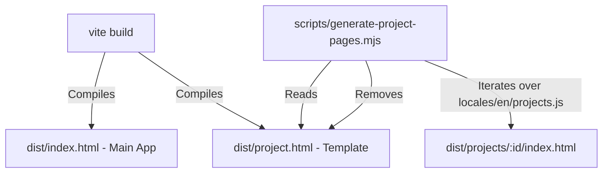
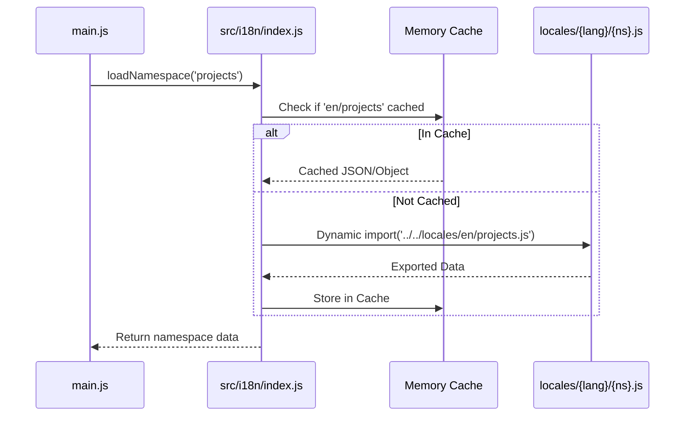

# System Architecture & Technical Specifications

This document outlines the architectural patterns, component design, routing mechanisms, and build pipeline powering `dvbarannik.github.io`.

---

## 1. High-Level Architectural Goals

- **Zero-Dependency Core:** The user interface runs on standard web technologies (HTML5, ES2022+ modules, modern CSS). It avoids heavyweight frontend frameworks (React, Angular, Vue) to guarantee minimal bundle size, instant First Contentful Paint (FCP), and optimal Core Web Vitals (CWV).
- **Static First with Dynamic Enhancements:** The main page loads statically and progressively enhances with interactivity (theme switching, filter buttons, deep-dive modal dialogs).
- **Search Engine & Social Media Optimization (SEO & SMO):** Individual project pages are pre-rendered at build time with specific OpenGraph and Twitter card metadata for optimal sharing.
- **Architectural Parity Across Domains & Projects:** The architecture treats every project and technological domain (Android, KMP, Flutter, Web, Embedded, IoT, Applied Research & Grants) as a first-class citizen. There are no "minor" or downgraded components; every project enjoys the same rigorous presentation, pre-rendered static routes, and deep technical articulation.

---

## 2. Multi-Page & Routing Architecture

The project employs a hybrid approach: an interactive single-page portfolio at `/` and pre-rendered standalone landing pages for each project under `/projects/:id`.

### 2.1 Main Portfolio (`index.html` + `src/main.js`)
- Served as the primary application root.
- Handles internal section hash navigation (`#about`, `#experience`, `#projects`, `#skills`, `#research`, `#contact`).
- Injects dynamic HTML for the interactive timeline, projects grid, skills cloud, and research publications based on the active language.

### 2.2 Project Detail Pages (`project.html` + `src/project.js`)
- `project.html` defines the structural skeleton for standalone project pages.
- `src/project.js` detects the project ID from the URL path (`/projects/:id`), loads localized project data, and renders the complete technical deep dive.
- If a project is not found, it gracefully presents an error message with a return navigation button.

### 2.3 Post-Build Static Site Generation (SSG)
- Implemented in [`scripts/generate-project-pages.mjs`](file:///Users/dima_barannik/Documents/GitHub/dvbarannik.github.io/scripts/generate-project-pages.mjs).
- Executes automatically during `npm run build`.
- For each project defined in `locales/en/projects.js`:
  1. Creates directory `dist/projects/<project-id>/`.
  2. Injects pre-calculated `<title>`, `<meta property="og:title">`, `<meta property="og:description">`, and `<meta property="og:image">` tags into the compiled HTML template.
  3. Writes `dist/projects/<project-id>/index.html`.
  4. Deletes the intermediate `dist/project.html` file to avoid orphan endpoints.

---

## 3. Localization (i18n) Engine

The localization subsystem is implemented in [`src/i18n/index.js`](file:///Users/dima_barannik/Documents/GitHub/dvbarannik.github.io/src/i18n/index.js) and is designed for zero latency and zero framework dependencies.

### 3.1 Features
- **Namespace Splitting:** Content is split into distinct domains (`ui`, `projects`, `experience`, `education`, `skills`, `skillsDetails`, `research`). Users only load what is needed.
- **Vite Chunking:** Vite automatically creates code-split chunks for each locale namespace file upon import.
- **In-Memory Cache:** Once a locale namespace is retrieved, subsequent language toggles or re-renders read directly from memory.
- **Automatic Language Detection:** Inspects `localStorage.getItem('lang')`. If empty, inspects `navigator.language`; users with Ukrainian or Russian system settings default to `'uk'`, while all others default to `'en'`.

---

## 4. State Management & Lifecycle

Because the application uses Vanilla JavaScript, state management is explicit and lightweight:

1. **Active Language State:** Managed via `src/i18n/index.js`. Changing the language updates `localStorage` and triggers `renderAll()`.
2. **Active Theme State:** Stored in `localStorage.getItem('theme')` (`'dark'` vs `'light'`). Controlled by toggling the `light-theme` class on `document.body`.
3. **Active Project Modal State:** Tracked in `main.js`. Clicking a project card loads the project object, populates the `<dialog>` or overlay modal, prevents background scrolling, and fires an analytics event.
4. **Project Filters:** Categorical filtering (e.g., Mobile, Web, Systems, Research) filters DOM cards dynamically using CSS data attributes without reloading the page.

---

## 5. Styling Architecture

- Located in [`src/style.css`](file:///Users/dima_barannik/Documents/GitHub/dvbarannik.github.io/src/style.css) and [`src/project.css`](file:///Users/dima_barannik/Documents/GitHub/dvbarannik.github.io/src/project.css).
- Utilizes CSS Custom Properties (`--bg-primary`, `--text-primary`, `--accent`, `--border-subtle`, `--company-*`).
- Supports high-contrast light mode with automated CSS variable swaps under `body.light-theme`.
- Enforces strict fluid typography using `clamp()` expressions for perfect responsiveness across mobile, tablet, laptop, and ultra-wide displays.
- Hardware-accelerated CSS animations (`transform`, `opacity`) wrapped inside `@media (prefers-reduced-motion: no-preference)`.

---

## 6. Analytics & Event Tracking

Implemented in [`src/analytics.js`](file:///Users/dima_barannik/Documents/GitHub/dvbarannik.github.io/src/analytics.js) via Firebase Analytics (v12 SDK):

| Event Name | Trigger | Parameters |
| :--- | :--- | :--- |
| `page_view` | Initial page load or route change | `page_path`, `page_title` |
| `cv_download` | Click on "Download CV" button | `link_id`, `locale` |
| `project_view` | Opening a project modal or navigating to project page | `project_id`, `project_name` |
| `language_change` | User switches language toggle | `selected_language` |
| `theme_change` | User toggles dark/light mode | `selected_theme` |
| `outbound_click` | Clicks on external GitHub/LinkedIn/Live links | `destination_url` |

All tracking respects privacy settings and handles connection dropouts gracefully without affecting user experience.

---

## 7. Build and Deployment Pipeline

- **Bundler:** Vite 5 configured in `vite.config.js`.
- **Output:** Clean static bundle generated to `dist/`.
- **Hosting:** GitHub Pages deployed from the repository branch or via GitHub Actions.
- **Clean URLs:** GitHub Pages serves directory `index.html` files cleanly (e.g., `dvbarannik.github.io/projects/astra-reskin/`).
