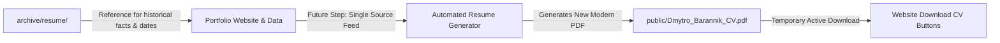

# Resume Modernization Strategy & Generation Roadmap

This document outlines the strategic vision, design standards, and technical architecture for developing an automated, contemporary, ATS-friendly resume generator for Dmytro Barannik.

---

## 1. Executive Summary & Goals

The goal of this initiative is to replace manual Word/PDF resume maintenance with a modern, automated, and design-led generation pipeline.

### Strategic Distinction: Portfolio vs. Resume
- **Portfolio Website (`dvbarannik.github.io`):** Interactive, visual-first, multi-media showcase offering deep technical exploration, live project demonstrations, and full chronological context.
- **Downloadable Resume (PDF):** A concise, high-impact, scannable document optimized for executive review (6-second scan) and 100% compliance with Applicant Tracking Systems (ATS).

---

## 2. Current State & Immediate Workflow



1. **Legacy Files in `archive/resume/`:** Historical resumes (`Android developer_ Dmytro B 31.01.25.docx` and `.pdf`) serve strictly as background reference to retrieve historical dates and specific technical duties. They are **not** distributed.
2. **Current Download (`public/Dmytro_Barannik_CV.pdf`):** Retained temporarily in `public/` so that existing "Download CV" links in the header and hero sections remain operational without 404 errors.
3. **Target State:** The automated resume generator will overwrite `public/Dmytro_Barannik_CV.pdf` with the newly formatted modern PDF.

---

## 3. Resume Design & ATS Standards

### 3.1 Content Structure & Hierarchy
- **Header:** Full name, title (**Software Engineer · Tech Lead · PhD**), location (Ukraine · Remote/International), links (Portfolio, LinkedIn, GitHub, Email).
- **Executive Summary:** 3–4 sentences articulating technical breadth, leadership record, and research background.
- **Core Competencies Matrix:** Organized by functional area (Mobile Engineering, Systems & Security, Backend & Cloud, Leadership & Architecture).
- **Professional Experience:** Reverse chronological order using the STAR impact framework (Situation, Task, Action, Result) with measurable metrics.
- **Education & Applied Research:** PhD details, military institute background, selected high-impact publications, patents/research achievements.

### 3.2 ATS (Applicant Tracking System) Best Practices
- **Text Layer Integrity:** Pure vector text rendering; no rasterized text or images of text.
- **Standard Semantic Headings:** Use conventional titles ("Experience", "Education", "Skills", "Summary") that ATS parsers recognize without ambiguity.
- **Single/Dual Column Balance:** Avoid complex nested tables or overlapping floating divs that disrupt linear text extraction in older parser software.
- **Page Budget:** Exactly 2 pages for Senior/Lead/PhD profile (or a dedicated 1-page condensed executive format).

---

## 4. Technical Architecture for Generator

As agreed during design planning, the generator will leverage an **HTML/CSS print template + automated headless PDF renderer**:

```mermaid
graph TD
    Data[src/companies.js & locales/] -->|Injects Data| Template[src/resume/template.html]
    Styles[src/resume/print.css] -->|@media print styles| Template
    Template -->|Rendered via Headless Browser| Puppeteer[Puppeteer / Playwright CLI]
    Puppeteer -->|Outputs Vector PDF| Output[public/Dmytro_Barannik_CV.pdf]
```

### Advantages of this Stack:
- **Design Parity:** Shares typography tokens, color harmonies, and iconography with the main portfolio web stack.
- **Pixel-Perfect CSS Paging:** Uses modern CSS Paged Media standards (`@page { size: A4; margin: 12mm; }`, `break-inside: avoid;`).
- **Automation Ready:** Can run locally via `npm run generate:cv` or automatically in GitHub Actions on every release.

---

## 5. Phased Implementation Roadmap

### Phase 1: Structure & Strategy (Completed)
- [x] Isolate historical resumes into `archive/resume/`.
- [x] Document archive purpose and usage guidelines.
- [x] Author comprehensive resume strategy and standards (`docs/RESUME_STRATEGY.md`).
- [x] Maintain temporary download link in `public/Dmytro_Barannik_CV.pdf`.

### Phase 2: HTML/CSS Print Template Development
- [ ] Create dedicated template layout (e.g., `resume.html` or `src/resume/`).
- [ ] Implement responsive print stylesheet utilizing portfolio fonts and clean typography.
- [ ] Draft concise, STAR-aligned resume content based on portfolio data and legacy archive facts.

### Phase 3: Automated PDF Rendering Pipeline
- [ ] Add headless rendering script (e.g., `scripts/generate-resume-pdf.mjs` using Puppeteer).
- [ ] Add npm script `"generate:cv": "node scripts/generate-resume-pdf.mjs"`.
- [ ] Verify ATS parseability using PDF text extraction tools (`pdftotext`, ATS previewers).

### Phase 4: Production Deployment & CI/CD
- [ ] Output finalized PDF to `public/Dmytro_Barannik_CV.pdf`.
- [ ] Wire CV generation into the standard build pipeline (`npm run build`).
- [ ] Update website download analytics and release notes.
